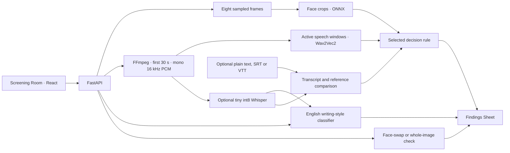

# VeriSight

**Multimodal NLP for Deepfake Detection and Explainable Content Verification**
Bennett University · CSET 346 PJ-07 and IMDAI · November 2026

VeriSight inspects faces, speech, images and English writing on CPU. For captioned recordings, it can transcribe the speech, compare the supplied words with the transcript, and show which evidence changed the decision. Each finding carries a detector-specific score or an abstention reason. REAL and FAKE are operational labels for the selected task. A writing-style estimate cannot establish who wrote a passage.

## Architecture



| Check | Pretrained weights | Observation |
|---|---|---|
| Face swap | `Samson5827/deepfakeguard-v2` | ONNX CPU, MTCNN with Haar fallback, 18% margin, 224×224 RGB. Read publisher label JSON, convert the single sigmoid to the fake-class score. |
| Whole-image synthesis | `Organika/sdxl-detector` | Swin image classifier; read the artificial class from the loaded config. |
| Acoustic synthesis | `Gustking/wav2vec2-large-xlsr-deepfake-audio-classification` via the `pranjal-pravesh` INT8 ONNX export | FFmpeg decodes WAV, MP3, M4A, AAC, OGG, FLAC and video audio to 16-bit PCM. Twenty-millisecond energy frames trim silence. Five-second windows with at least 0.5 s of active signal contribute to an active-duration-weighted median. Four seconds is configurable. |
| English writing style | `fakespot-ai/roberta-base-ai-text-detection-v1` | Deterministic langdetect gate, ≥50 characters and ≥10 words. Up to 512 tokens per forward, 96-token overlap, weighting by newly covered tokens. Token-window offsets and up to eight independently scored sentences expose local variation. |
| Transcript | `Systran/faster-whisper-tiny` | CTranslate2 CPU int8 with VAD, one beam, two CPU threads. The language detector and writing-style gate also apply to recognized text. |

Set `inference.audio_model` or `inference.text_model` in `configs/default.yaml` to select a supported checkpoint. The default `pranjal-pravesh/wav2vec2-large-xlsr-deepfake-audio-classification` uses the pinned ONNX graph and its Gustking parent’s label and preprocessing configs. PyTorch options are `MelodyMachine/Deepfake-audio-detection-V2`, `Hemgg/Deepfake-audio-detection` and `garystafford/wav2vec2-deepfake-voice-detector`. The Gary Stafford loader reads one layer at a time and applies dynamic INT8 quantization to linear layers. The health endpoint and each acoustic finding identify the configured model. The `rasbt/ai-text-detector-modernbert` alternate publishes explicit HUMAN/AI labels. Selecting `GeorgeDrayson/modernbert-ai-detection` with its current generic labels produces a diagnostic abstention. Runtime checks reject ambiguous and unexpected class mappings.

**Memory.** The shared serving pipeline holds one classifier or ASR bundle at a time. A lock covers loading and use. Switching evicts the previous bundle and runs `gc.collect()`. The face detector includes its small crop detector. Use one server worker. Video frames are sampled sequentially and reduced to a maximum 960-pixel side before storage. Standalone images are limited to 24 megapixels. Decoding and ASR cover at most 30 seconds. The engineering target is a process working set below 1.2 GB. Media dimensions, imports, allocator behavior and concurrent processes affect total system use.

## Decisions and NLP evidence

- `disagreement_max` flags a usable stream above its own upper boundary. A REAL decision requires all requested streams to fall below their lower boundaries. Otherwise the system abstains. Its ranking statistic is the maximum available score. `fusion.score` remains null.
- `confidence_weighted_fusion` averages available scores using quality × |2p−1|. Quality weights use detected faces out of eight, active acoustic seconds up to five, and reference/transcript word counts up to twenty. Its uncalibrated index has a default uncertainty band of 0.40–0.60. Missing required evidence blocks an overall REAL. Zero total weight yields a null score.
- Inclusive uncertainty bands default to 0.35–0.65 for text/caption mismatch and 0.45–0.55 for face-video and acoustic scores. Tune only on independently labeled validation data. Standalone image checks retain their 0.50 threshold.
- WER and CER use the supplied caption as reference after Unicode normalization, case folding and punctuation removal. Insertions can produce values above 1. TF-IDF cosine measures lexical overlap. The mismatch signal is one minus that cosine. It can flag an inconsistent caption even when face and voice evidence is low. Independently scored transcript writing style appears as context.
- With ASR disabled, captions are displayed as unavailable for comparison. When ASR is enabled, a supplied caption introduces a requested evidence stream. For SRT/VTT, comparison includes cues starting within the analyzed interval. Supply time-aligned plain text for the first 30 seconds. Burnt-in subtitles require an external transcription or caption file.

## Run the CSET 346 demo locally

**Before starting the multimodal NLP demo, set `inference.asr_enabled: true` in `configs/default.yaml` and restart FastAPI.** Upload an audio or video recording with a reference caption to see the transcript, WER, CER and lexical similarity.

Use Python 3.12, FFmpeg on PATH, Node.js 18+ and npm. Run from the repository root. The optional `asr` extra installs faster-whisper.

**Windows PowerShell**

```powershell
py -3.12 -m venv .venv
.\.venv\Scripts\python.exe -m pip install torch==2.2.2 torchvision==0.17.2 torchaudio==2.2.2 --index-url https://download.pytorch.org/whl/cpu
.\.venv\Scripts\python.exe -m pip install -e ".[dev,asr,faces]"
.\.venv\Scripts\python.exe -m scripts.sanity_check_live --download
.\.venv\Scripts\python.exe -m uvicorn src.api.main:app --host 127.0.0.1 --port 8000 --workers 1
```

**Optional ModernBERT runtime on Windows**

The default environment preserves the MTCNN package's PyTorch 2.2 dependency. ModernBERT on Python 3.12 needs a newer PyTorch runtime to import its model class. Create a separate CPU environment and set `inference.text_model` in `configs/default.yaml` to `rasbt/ai-text-detector-modernbert`. This configuration uses Haar face detection when MTCNN is absent. The first text inference downloads the alternate checkpoint. The loader reads its tokenizer graph, uses eager attention, retains the checkpoint's BF16 weights and applies its stored temperature. A single-passage CPU test peaked at 715.0 MB.

```powershell
py -3.12 -m venv .venv-modernbert
.\.venv-modernbert\Scripts\python.exe -m pip install torch==2.5.1 torchvision==0.20.1 torchaudio==2.5.1 --index-url https://download.pytorch.org/whl/cpu
.\.venv-modernbert\Scripts\python.exe -m pip install -e ".[dev,asr]"
.\.venv-modernbert\Scripts\python.exe -m uvicorn src.api.main:app --host 127.0.0.1 --port 8000 --workers 1
```

**Linux**

```bash
python3.12 -m venv .venv
source .venv/bin/activate
python -m pip install torch==2.2.2 torchvision==0.17.2 torchaudio==2.2.2 --index-url https://download.pytorch.org/whl/cpu
python -m pip install -e '.[dev,asr,faces]'
python -m scripts.sanity_check_live --download
python -m uvicorn src.api.main:app --host 127.0.0.1 --port 8000 --workers 1
```

In a second terminal, run `cd frontend`, `npm ci` and `npm run dev`. Open the [Screening Room](http://localhost:5173) or [interactive API docs](http://127.0.0.1:8000/docs). The server exposes POST `/api/predict` (video), `/api/predict/video-text`, `/api/predict/audio`, `/api/predict/image` and `/api/predict/text`. Send multipart `file` for uploads, optional `text` or UTF-8 `subtitles` for audio/video, and `check_type=face_swap|general_ai` for images. Text accepts JSON `{"text":"..."}`. Supply `?strategy=confidence_weighted_fusion` to override the configured strategy for one recording.

## Verification and evaluation

```powershell
.\.venv\Scripts\python.exe -m pytest tests/ -v
.\.venv\Scripts\python.exe -m scripts.verify_all_modalities
.\.venv\Scripts\python.exe -m scripts.sanity_check_live
.\.venv\Scripts\python.exe -m scripts.evaluate_benchmark data/test.csv --asr --output reports
```

The live check prints six scores with their expected and observed decisions: a 2014 NASA news excerpt, Don Pettit's casual 2012 blog prose, Austen, and three assistant-generated passages. It reports decision accuracy on these fixtures and checks score ordering within each pair. An abstention counts as unresolved; a directional pass can coexist with wrong threshold decisions. Use `--text-only` to run that portion alone. In the ModernBERT environment, add `--text-model rasbt/ai-text-detector-modernbert`. Use `--real-text` and `--generated-text` for a custom pair. The audio check compares a LibriSpeech excerpt with the bundled synthesized voice and verifies M4A and AAC decoding. Use `--real-audio` and `--synthetic-audio` for local fixtures. A failed ordering exits nonzero. [LibriSpeech recording](https://librosa.org/data/audio/5703-47212-0000.ogg)

A benchmark CSV accepts `path,label,caption` or the repository's FakeAVCeleb `video_path,overall_label` columns. Paths resolve against the CSV directory unless `--root` is supplied. Labels are REAL or FAKE; caption is optional. Alternatively point the evaluator at a directory with `REAL/` and `FAKE/` subdirectories. Include provenance, consent/license, domain and identity split information in your dataset documentation. Use a held-out source/identity-disjoint manifest and evaluate an unseen domain separately. The pipeline performs inference only.

The evaluator writes `metrics.json`, `predictions.csv`, `ablation.csv`, and `error_analysis.md/.csv`. Video baselines and both fusion methods see the same sample rows. Text-only uses transcript writing style as a deliberately weak proxy for the overall video label. On standalone inputs, cohorts retain their own task labels. Precision/recall target FAKE. Accuracy, F1 and the REAL/FAKE confusion matrix use decided samples. Abstention rate and per-class abstention counts include every row. ROC-AUC and trapezoidal PR-AUC use all rows with numerical rankings, including gray-zone cases. Undefined metrics are null. Error exports contain at most 20 distinct samples, prioritizing wrong decisions and abstentions. A human reviewer must inspect and annotate the cases.

## Observed limitations

On the five-clip selection set, Gustking INT8 classified both human voices and all three synthetic clips correctly (797.8 MB peak Windows working set). MelodyMachine V2 missed two synthetic voices. Hemgg and Gary Stafford flagged both human voices. The selection used the existing decision bands. These five clips also informed the choice of default, so any accuracy claim requires a separate held-out set.

Fakespot classified 3/6 passages correctly, including both long generated prose and short generated news. It abstained on the generated casual note. ModernBERT got 4/6, including Austen, but scored the human news passage above its generated counterpart and labeled the generated casual note REAL. The one additional correct decision on these fixtures does not establish a clear advantage. Fakespot remains the default. The individual model scores, selection-set provenance and memory measurements are in the audit.

These fixtures expose failure modes. The repository contains no completed held-out evaluation demonstrating stronger accuracy, calibrated probabilities, superior fusion, robust cross-generator performance or faithful localization. Accents, compression, noise, brief speech, ASR mistakes and paraphrases can affect the result. Energy gating admits some nonspeech. Sentence and chunk scores describe model sensitivity and offer no causal account of authorship. Use consented media and keep identifiable recordings and transcripts local. See [the implementation audit](AUDIT_REPORT.md) for the original defect reproduction and checkpoint evidence.
